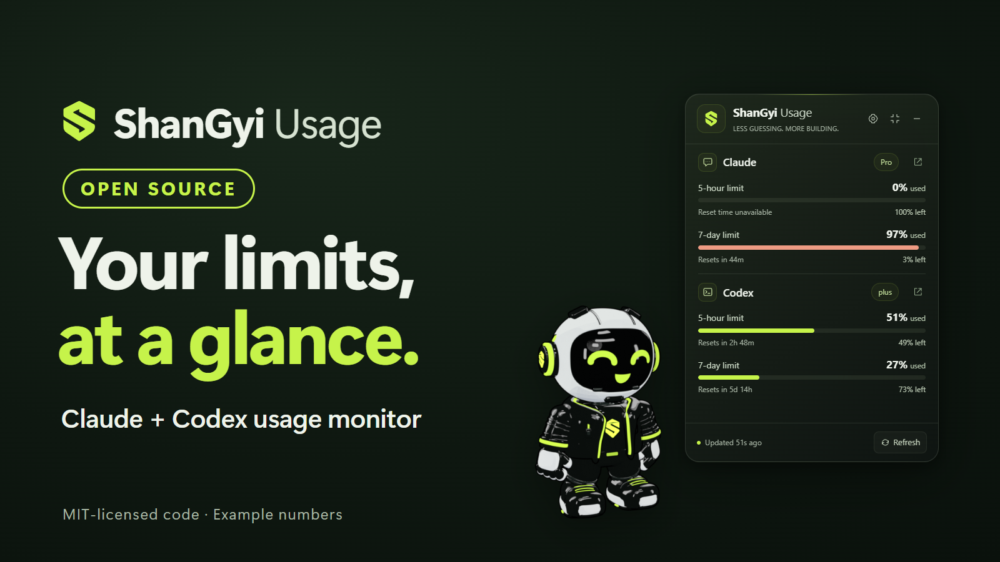
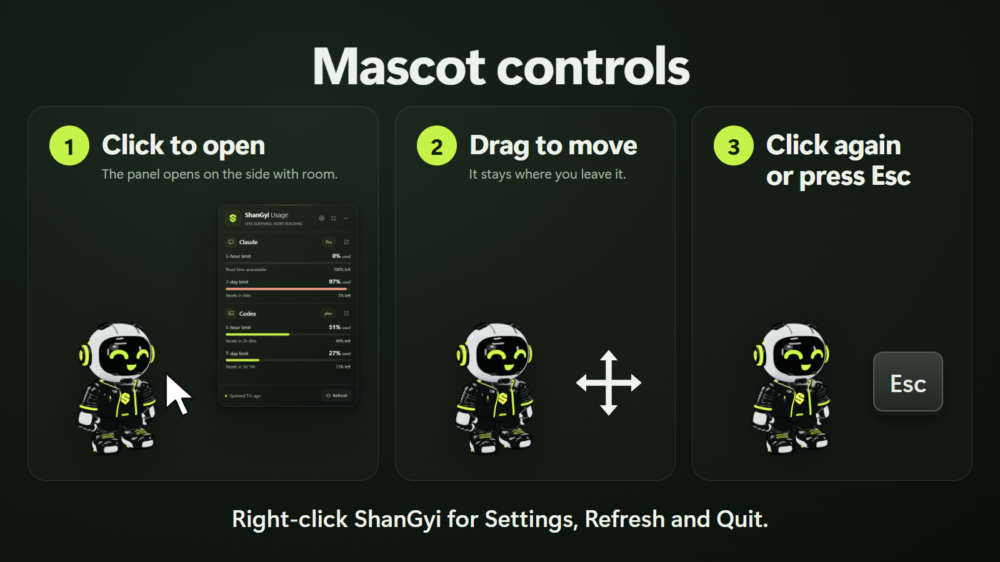
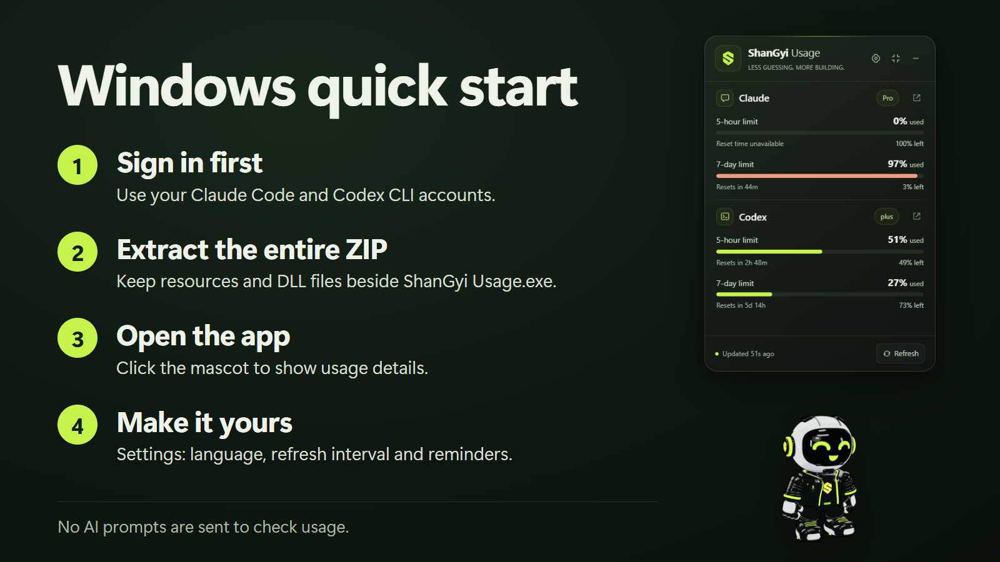
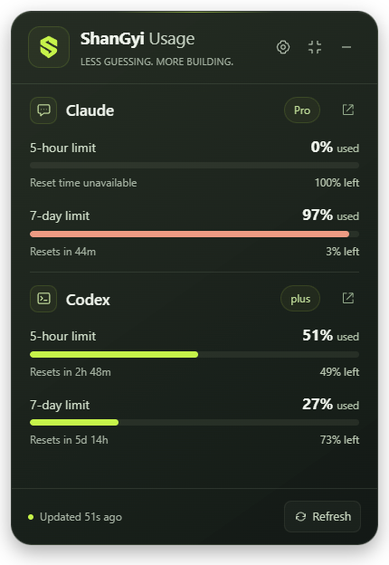

# ShanGyi Usage

[English](README.md) · [မြန်မာ](README.my.md) · [ไทย](README.th.md)



A small Windows desktop companion for Claude and Codex usage limits, with the
original ShanGyi **3D toon mascot**. The app starts with just the mascot.
Click ShanGyi to open the usage panel. It opens above the mascot, or below or
beside it when there is no room, and the mascot stays where you put it.
Click again (or press Escape) to close the panel. Dragging moves the pet
without opening the panel. Right-click ShanGyi for Settings, Refresh and Quit.



The images use example numbers; percentages and reset times change with your account. The source code is MIT licensed; ShanGyi artwork has its separate [brand asset license](BRAND-ASSETS-LICENSE.md).

> **Independent project.** ShanGyi Usage is not affiliated with, endorsed by,
> or sponsored by Anthropic or OpenAI. "Claude" and "Codex" are their owners'
> names and are used only to say which accounts the app reads. No provider
> logos are included.

## Run the Windows build



Download `ShanGyi-Usage-<version>-win-x64.zip` from the
[Releases page](https://github.com/saimwankhaung/shangyi-usage/releases).
You can check the download against `SHA256SUMS.txt` from the same release:

```powershell
Get-FileHash .\ShanGyi-Usage-0.1.6-win-x64.zip -Algorithm SHA256
```

The executable is not code-signed, so Windows SmartScreen may say it
"protected your PC". Choose **More info → Run anyway** only if the checksum
matches the release.

1. Extract the entire portable ZIP to a folder. Keep the DLLs and `resources`
   beside the executable.
2. Open **ShanGyi Usage.exe**. No installer, Node.js, or account password is
   needed to launch the portable widget.
3. Sign in to the Codex CLI with `codex login` if needed. The widget detects
   the Codex desktop app's bundled CLI on Windows, or uses `codex` on PATH.
   Settings also lets you choose `codex.exe` yourself.
4. For Claude, choose your source in Settings:
   - **VS Code extension**: the widget detects the installed Claude executable
     and automatically reads the account already signed into Claude Code.
     Usage refreshes every minute by default; no reload or AI prompt is needed.
     An optional launcher bridge remains available for older CLI versions.
   - **Claude terminal**: click Connect, then use the interactive Claude Code
     terminal normally. The terminal status line supplies its quota snapshot.
   This app never sends an AI prompt to obtain a quota.

For a one-click local VS Code setup, run **Setup VS Code Bridge.cmd** from
the extracted app folder. It backs up/configures the wrapper setting, selects
the VS Code source, restarts only ShanGyi Usage, and opens the widget. It does
not reload VS Code. Save your work and run Developer: Reload Window yourself.
The setup uses the bundled runtime and does not require a Node.js installation.

> **Keep the folder while the VS Code bridge is connected.** VS Code then starts
> Claude Code through `ShanGyiClaudeBridge.exe` in this folder. If the folder is
> moved or deleted, Claude Code in VS Code can no longer start. Before you move
> or delete it, open Settings and click **Restore**. See
> [Remove the app](#remove-the-app) if the folder is already gone.

The minus button hides the app to the system tray. Left-click the tray icon to
show it again; right-click for refresh, usage details, Settings, always-on-top and quit.
Settings supports English, Burmese and Thai (Language → ไทย), animation on/off, optional launch at
sign-in, and usage reminders at 80%, 95% and 100%.
Reminders are quiet on startup, appear once per threshold per limit cycle,
and retain their history when the app reopens. Warnings from the same provider
have a 30-minute cooldown; reaching 100% can still alert once. Simultaneous
window warnings are grouped in one notification. Small percentage changes or
reset timestamp drift do not repeat a reminder.

Releases are for Windows x64 only, and the Windows build is unsigned. The
source can also build macOS development previews (see below); they are not
published as releases. The optional Claude wrapper/status-line setup is
Windows-specific. The executable and tray use the supplied ShanGyi logo.
Provider logos are not bundled; see [ASSETS.md](ASSETS.md).

## Reading the usage panel



- The badge beside each provider shows the returned plan, such as **Pro** or **plus**. If the provider supplies no plan name, the app does not guess one.
- **Used** is the consumed percentage; **left** is the remaining percentage. The 5-hour and 7-day limits are independent windows.
- **Resets in** shows the provider's reset time. **Reset time unavailable** means no reset time was returned; the app keeps it unknown.
- **Updated** tells you how old the measurement is. **Last known** means the data is stale; an expired countdown does not set usage to zero.
- **Refresh** requests a new measurement. It does not send an AI prompt.

This capture uses example numbers. It is not a fixed quota or a promise that every plan exposes the same windows.

## What “live” means

**Codex:** uses the official `codex app-server` JSON-RPC interface. It reads
`account/read` and `account/rateLimits/read`, listens for
`account/rateLimits/updated`, and refreshes every 60 seconds by default
(configurable: 30, 60, 120 or 300 seconds). A separate app-server process
cannot promise to instantly receive changes made in every other client;
polling reconciles those changes. Account plan names and quota durations are
read from the provider, not hardcoded to Plus or Pro.

**Claude with the VS Code source:** detects the extension's bundled CLI, with
the standalone CLI as a fallback. It starts the CLI in config-only mode
(`--print --input-format stream-json --output-format stream-json` with the
environment variable `CLAUDE_CODE_CONFIG_PROBE=1`) and sends `initialize` and
`get_usage`, the same account-usage control request used by the installed
extension. There are no user messages or AI turns. Internal entries without
a user-facing meaning (currently `iguana_necktie`) are not shown. The CLI manages authentication;
ShanGyi does not read credential stores. The official CLI's `auth status`
command supplies the subscription name (for example, Pro or Max); account
identifiers and authentication data are discarded. Only the plan name,
percentages, reset times and observation time are persisted. Disabled credit limits are omitted.
This upstream interface is undocumented and experimental, and can change in
any Claude Code release; unsupported versions/accounts show an
explicit waiting/error state and retain last known values. The refresh interval
applies to both account readers. Standard local Claude sign-in is supported;
custom VS Code environment/profile account locations are not imported.

## macOS (development previews, not released)

macOS uses the automatic Claude account reader; no PowerShell or EXE wrapper
is installed. Install Claude Code and sign in through it. Detection supports
the VS Code extension's native binary, `~/.local/bin/claude`, `/opt/homebrew/bin`,
`/usr/local/bin`, and PATH. Codex is detected in `/Applications/Codex.app` or
`ChatGPT.app` (also under `~/Applications`), Homebrew and PATH. Settings can
select a different Codex CLI executable. GUI launches include the standard
CLI directories in the child process PATH.

Choose `macOS-arm64` for Apple Silicon and `macOS-x64` for Intel. Each ZIP
contains `ShanGyi Usage.app`; framework symlinks and executable permissions
are preserved. Cross-built ZIPs are development previews, not a confirmed
ready-to-install public Mac release. A real Mac is needed to confirm quota
reads, floating-window behavior, login-item handling and security checks.

To build locally on a Mac, install Node.js 22.12+ and Python 3, then run
`npm ci`, `npm test`, `npm run smoke`, and `npm run package`. The packaging
script creates and verifies an ad-hoc signature. It does not notarize the app.
Use `npm run package:mac -- --arch=arm64` or `--arch=x64` to target another
architecture. CI includes native checks/builds for both architectures;
those checks are only confirmed after a successful GitHub Actions run.

For Thai instructions, see [README.th.md](README.th.md).

**Optional VS Code launcher bridge:** uses the extension's supported
`claudeCode.claudeProcessWrapper` setting. A small Windows console helper
launches the exact bundled Claude executable and forwards arguments, stdin,
stdout, stderr and exit status. Small requests are flushed immediately so
interactive control requests cannot stall. It captures SDK `rate_limit_event`
fields, and `get_usage` responses matched to the extension's own request IDs.
Only utilization/reset fields are saved; unrelated responses are ignored.
Account-usage percentages and fractional event values are normalized separately.
The installed extension v2.1.295 exposes these fields during ordinary work;
older builds may omit utilization. No quota is guessed when they do.

The helper does not read authentication stores or copy a chat transcript. The
existing Claude process manages its own authentication. Its normal protocol
messages pass through unchanged to VS Code; only quota fields are persisted
by ShanGyi. The helper does not start additional AI turns. The current folder
must remain available while the VS Code wrapper setting points to it.

**Claude in an interactive terminal:** uses Claude Code's documented status-line JSON, including
`rate_limits.five_hour`, `rate_limits.seven_day` and any other returned
percentage windows. A small local PowerShell bridge writes **only quota
fields, the model display name and the time the snapshot was received**.
No OAuth tokens, browser cookies, passwords, prompts, session identifiers,
working-directory paths or chat transcripts are collected.

The VS Code source can refresh account usage while the editor is closed,
using the installed CLI and its existing sign-in. Manual Refresh reads a new
account measurement. The terminal status-line and optional launcher bridge
update when Claude Code supplies data; those passive snapshots alone do not
keep refreshing while Claude is idle. The graphical VS Code extension does
not run the terminal status-line bridge.

According to current Claude documentation, subscription rate-limit fields
are supplied for Pro/Max and certain apps gateways, after an API response.
The UI is plan-independent, but **availability is not guaranteed for every
plan, API account or CLI version**. Unsupported accounts show a waiting or
unavailable state, not invented zero-percent quotas. The account reader shows
the returned subscription name. When no name is available, it shows Connected
without guessing a plan from the quota size.

Snapshots older than five minutes and quota windows whose reset time has
passed are marked **Last known**. Expiring a countdown never resets the
displayed usage to zero. Failed Codex refreshes preserve last known values
and indicate staleness. Demo mode is visibly labeled in both widget modes
and is never saved as the default for the next launch.

## Claude bridge setup and restore

VS Code Connect changes only `claudeCode.claudeProcessWrapper` in the user's
VS Code settings. It preserves JSONC comments and unrelated settings, backs
up an existing wrapper setting, and asks before replacing one. Restore puts
the previous wrapper setting back. Reload VS Code after a change and continue
a normal turn, or open Account & usage, to receive quota data. Workspace/profile settings can override
the user setting. The current automatic setup targets standard VS Code on
Windows; Insiders, remote extension hosts and custom profiles are not yet
automatically configured.

Terminal Connect installs `claude-statusline.ps1` into the app's local data folder and
adds a `statusLine` command to `%USERPROFILE%\.claude\settings.json` (or the
directory selected by `CLAUDE_CONFIG_DIR`). The command runs PowerShell with
`-NoProfile -NonInteractive -ExecutionPolicy Bypass` for this script only;
it does not change the machine's execution policy.

If there is already a custom status line, Connect asks before replacing it
and stores its previous setting locally. **Restore** removes the bridge and
restores that previous status-line value. Other Claude settings are retained.
Restore leaves subsequent user changes to `statusLine` alone. Project-level
Claude settings can override the user status line; make the user bridge the
active status line in that project if no snapshots arrive.

Rate-limit data is captured after ordinary Claude Code work or a VS Code
Account & usage read. Merely
installing the bridge does not produce a new usage measurement. Some older
CLI versions may need an update. If a CLI does not emit quota fields, the
widget tells you that data is unavailable rather than substituting context
window percentage or session token counts.

## Remove the app

1. Open Settings and click **Restore** for the Claude source you connected
   (VS Code extension and/or Claude terminal). This puts back your previous
   VS Code wrapper or status-line setting.
2. Quit ShanGyi Usage from the tray menu.
3. Delete the app folder, and `%APPDATA%\ShanGyi Usage` if you also want to
   remove its settings and saved quota snapshots.

If the app folder was deleted while the VS Code bridge was connected, Claude
Code in VS Code cannot start. To fix it by hand, open
`%APPDATA%\Code\User\settings.json` (VS Code: **Preferences: Open User
Settings (JSON)**), delete the `"claudeCode.claudeProcessWrapper"` line (or set
it back to your own wrapper), save, and run **Developer: Reload Window**. If
the terminal status line stops working, remove the `statusLine` entry that
runs `claude-statusline.ps1` from `%USERPROFILE%\.claude\settings.json`.

## Develop

Requirements: Node.js 22.12 or newer, npm, and Windows for the Windows bridge test.
Mac packaging also requires Python 3. The Windows bridge test is skipped on Mac.

```sh
npm ci
npm start
npm run demo
npm test
npm run smoke
npm run package
npm run docs:images
```

The first Electron launch may download its Windows runtime. `smoke` opens an
offscreen test window with a temporary profile and demo data; it does not touch
your Claude settings. It verifies video transparency, quota rendering,
mascot-only startup, click/drag behavior, the panel opening and closing with
its animation while the mascot stays in place (also at the top of the screen),
native resizing, English/Burmese/Thai switching, animations, and renderer
isolation. Screenshots are written to `test-results/`. `package` creates a
self-contained portable directory under `dist/`; ZIP that entire directory for
distribution. `docs:images` re-renders the README images
([docs/IMAGES.md](docs/IMAGES.md)).

See [CONTRIBUTING.md](CONTRIBUTING.md) before opening a pull request and
[SECURITY.md](SECURITY.md) to report a vulnerability.

Runtime uses Electron/Node built-ins plus `jsonc-parser` for preserving VS Code
settings. The VS Code helper uses Windows .NET Framework. No application server, analytics,
telemetry service, provider API key, or cloud database is needed.

## Architecture

```
app/main.cjs               window, tray, scheduling, IPC, settings
app/window-layout.cjs      where the window, mascot and panel go
app/model.cjs              quota normalization, staleness, mascot state
app/providers/codex.cjs     newline-delimited App Server RPC client
app/providers/claude.cjs    sanitized local quota snapshot reader
app/bridge-setup.cjs        install/restore the user status-line setting
app/vscode-setup.cjs        preserve/restore the VS Code wrapper setting
app/bridge/                Windows terminal and VS Code bridges
app/renderer/              isolated local widget UI
app/assets/mascot/         original supplied 3D toon WebM reactions
docs/source/               HTML the README illustrations are rendered from
tests/                     provider, snapshot privacy, restore, expiry and layout checks
```

Renderer runs with `nodeIntegration: false`, `contextIsolation: true`,
`sandbox: true`, a restrictive Content Security Policy, blocked navigation
and permissions, and narrowly scoped preload methods. Provider data enters
the UI as text, never provider-controlled HTML. Tokens remain managed by
the provider CLI. The bridge does not need provider credentials.

## Licensing

Source code is MIT licensed. ShanGyi mascot, logo, and icons use the separate
[ShanGyi Brand Assets License 1.0](BRAND-ASSETS-LICENSE.md). Ordinary personal
or internal use of the app, including at work, is allowed. Free non-commercial
redistribution is allowed with notices. The supplied assets cannot be sold or
commercially reused. To sell or commercially distribute a version, replace
the mascot, all ShanGyi logo/icon artwork, and product branding with your own
or appropriately licensed assets. See [ASSETS.md](ASSETS.md) for the file list.
These artwork restrictions do not change the MIT license on the code.
The repository contains open-source code and separately licensed artwork;
the artwork is not open source. Claude and Codex are their owners' names,
used only to identify the integrations; no provider logos are included.

## Status and limits

- Windows x64 portable ZIP only. It is not code-signed.
- Tested with one Claude Pro and one Codex Plus account. Other plans or CLI
  versions may report different windows, or none.
- The Claude account reader relies on an undocumented Claude Code interface
  and may stop working after a Claude Code update.
- macOS builds are development previews. They need testing on real Macs and
  Developer ID signing/notarization before a Mac release.

ShanGyi Usage is an independent project, not affiliated with Anthropic or
OpenAI.

## Official integration references

- [Codex App Server](https://learn.chatgpt.com/docs/app-server)
- [Claude Code status line data](https://code.claude.com/docs/en/statusline)
- [Claude Code VS Code settings](https://code.claude.com/docs/en/vs-code)
- [Electron security](https://www.electronjs.org/docs/latest/tutorial/security)

Changes in each version are listed in [CHANGELOG.md](CHANGELOG.md).
