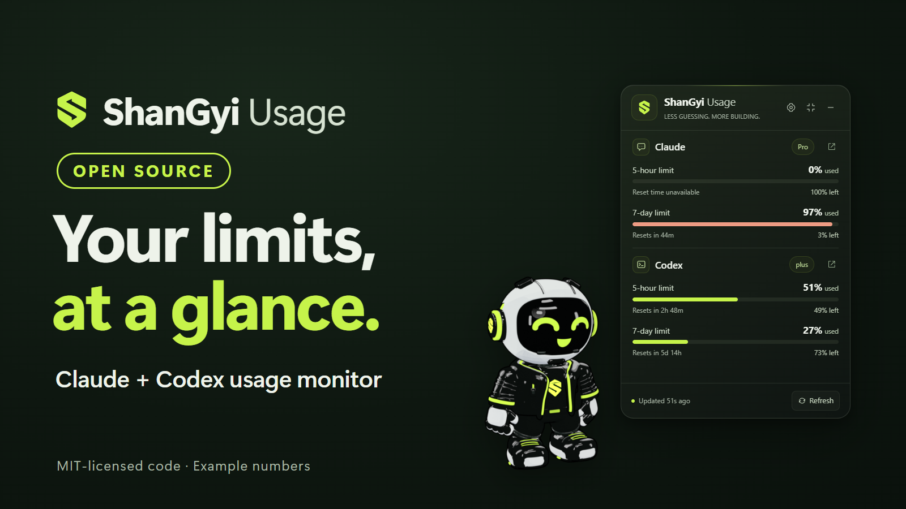
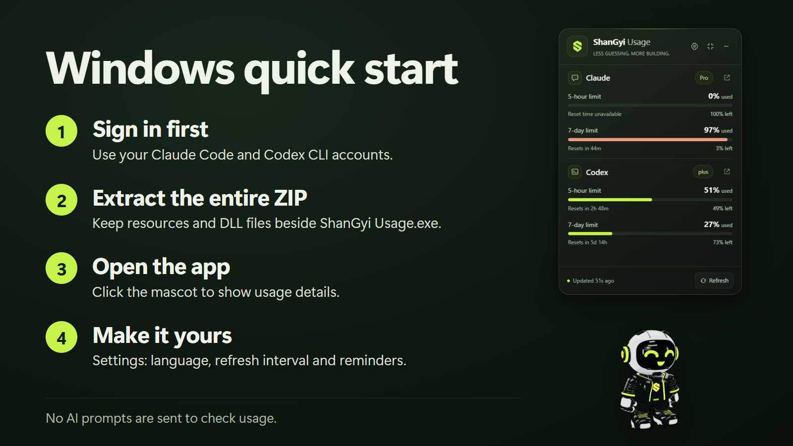
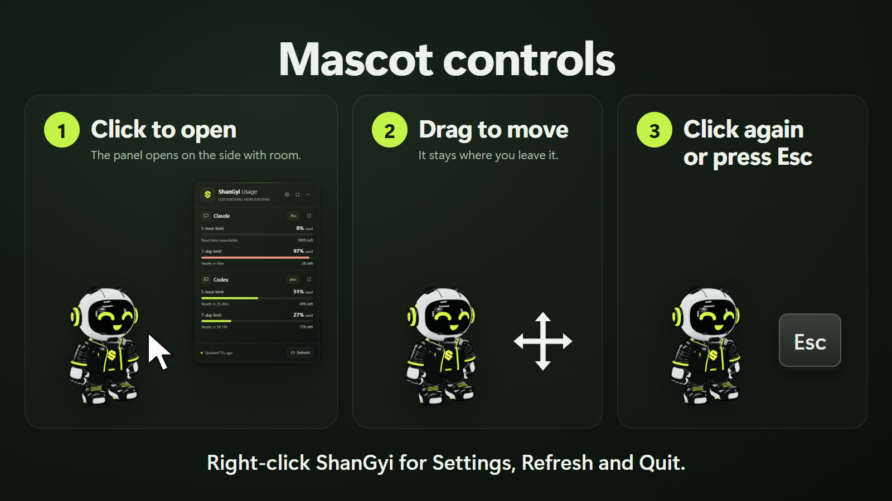
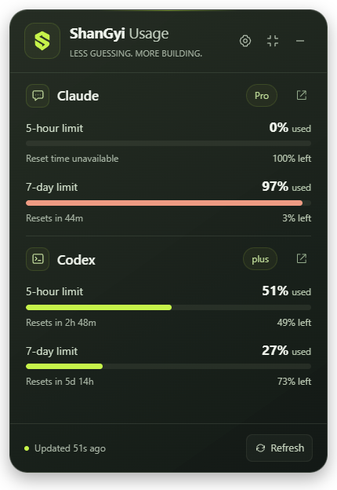

# ShanGyi Usage အသုံးပြုနည်း

[English](README.md) · [မြန်မာ](README.my.md) · [ไทย](README.th.md)

Claude နဲ့ Codex usage ကို စောင့်ကြည့်ဖို့ ShanGyi **3D toon mascot** ပါတဲ့
Windows floating widget ဖြစ်ပါတယ်။

> **သီးခြား project ဖြစ်ပါတယ်။** ShanGyi Usage သည် Anthropic သို့မဟုတ် OpenAI နဲ့
> ဆက်စပ်မှု မရှိပါ၊ သူတို့က ထောက်ခံထားတာ မဟုတ်ပါ။ "Claude" နဲ့ "Codex" ဆိုတာ
> ပိုင်ရှင်တွေရဲ့ နာမည်တွေဖြစ်ပြီး app က ဘယ် account ကိုဖတ်လဲ ပြောဖို့သာ သုံးပါတယ်။
> Provider logo တွေ မပါပါ။

## Windows စတင်သုံးပုံ

[Releases page](https://github.com/saimwankhaung/shangyi-usage/releases) မှ
`ShanGyi-Usage-<version>-win-x64.zip` ကို download လုပ်ပါ။ Release ထဲက
`SHA256SUMS.txt` နဲ့ `Get-FileHash` (PowerShell) ဖြင့် ဖိုင်မှန်ကြောင်း စစ်နိုင်ပါတယ်။
EXE ကို code-sign မလုပ်ထားလို့ Windows SmartScreen က သတိပေးနိုင်ပါတယ်။
Checksum ကိုက်မှသာ **More info → Run anyway** ကိုနှိပ်ပါ။

1. Portable ZIP ကို folder တစ်ခုထဲ အကုန် extract လုပ်ပါ။
2. **ShanGyi Usage.exe** ကိုဖွင့်ပါ။ EXE တစ်ဖိုင်တည်း သီးသန့်ရွှေ့မထားပါနှင့်။
   CLI အဟောင်းအတွက် optional VS Code bridge ကို ချိတ်လိုလျှင် app folder ထဲက
   **Setup VS Code Bridge.cmd** ကိုဖွင့်နိုင်ပါတယ်။ မူလ setting ကို backup ယူပြီး
   bridge ချိတ်ကာ widget ကို ပြန်ဖွင့်ပေးပါမယ်။ VS Code ကိုတော့ ကိုယ်တိုင် Reload လုပ်ပါ။
3. Codex login ဝင်ထားလျှင် usage ကို အလိုအလျောက်ဖတ်ပါမယ်။ မတွေ့လျှင်
   Settings → Codex CLI → Choose မှ `codex.exe` ကိုရွေးပါ။
4. Claude အတွက် Settings → Claude source မှ သုံးသည့်နေရာကိုရွေးပါ။
   **VS Code extension** သုံးလျှင် installed Claude Code ရဲ့ signed-in account
   ကို အလိုအလျောက်ဖတ်ပြီး တစ်မိနစ်တစ်ကြိမ် usage ပြန်စစ်ပါမယ်။
   Connect, Reload သို့မဟုတ် AI prompt အသစ် မလိုပါ။
   CLI အဟောင်းက account usage မပေးနိုင်လျှင် optional bridge ကို သုံးနိုင်ပါတယ်။
   **Claude terminal** သုံးလျှင် အဲဒီ source ကိုရွေးပြီး Connect လုပ်ပါ။
   Terminal status-line bridge က VS Code graphical panel အတွက် မဟုတ်ပါ။
5. Settings → Language မှ English၊ မြန်မာ၊ **ไทย** ကို ရွေးနိုင်ပါတယ်။

## macOS (development preview၊ release မထုတ်ပါ)

Mac အတွက် Apple Silicon ကို **macOS-arm64**၊ Intel ကို **macOS-x64** ရွေးပါ။
ZIP ထဲတွင် `ShanGyi Usage.app` ပါပါတယ်။ Mac က Claude Code account reader ကို
သုံးပြီး Windows-only bridge မလိုပါ။ Claude Code / Codex CLI ကို ကိုယ့် Mac မှာ
install လုပ်ပြီး sign in ဝင်ထားရပါမယ်။ Homebrew နဲ့ ပုံမှန် CLI paths ကို ရှာပါတယ်။
ဒီ Windows စက်မှ ထုတ်ထားသော Mac ZIP သည် unsigned development preview ဖြစ်ပြီး
Mac ပေါ်မှာ တကယ် run ပြီး မစစ်ရသေးပါ။ Public release အတွက် Mac native testing၊
Developer ID signing နဲ့ notarization လိုသေးပါတယ်။ Mac ပေါ်မှာ source မှ build
လုပ်လျှင် `npm ci`၊ `npm test`၊ `npm run smoke`၊ `npm run package` သုံးနိုင်ပါတယ်။

## Mascot အသုံးပြုပုံ

ပထမဖွင့်ချိန်မှာ mascot ပဲ ပေါ်ပါတယ်။ တစ်ချက်နှိပ်မှ usage panel က mascot
အပေါ်ဘက်မှာ ပွင့်ပါတယ်။ အပေါ်မှာ နေရာမဆန့်ရင် အောက်ဘက် ဒါမှမဟုတ် ဘေးဘက်မှာ
ပွင့်ပြီး mascot ကတော့ ထားခဲ့တဲ့နေရာမှာပဲ ရှိနေပါတယ်။ ထပ်နှိပ်လျှင် သို့မဟုတ် Escape နှိပ်လျှင် ပြန်ခေါက်ပါတယ်။
Mascot ကို ဆွဲပြီး နေရာရွှေ့နိုင်ပါတယ်။ Right-click မှ Settings၊ Refresh နဲ့ Quit
ကို ရွေးနိုင်ပါတယ်။ Minus button က
system tray ထဲ ခေါက်ထားပေးပါတယ်။ Tray icon ကိုနှိပ်ပြီး ပြန်ဖွင့်နိုင်ပါတယ်။

## Usage panel ဖတ်ပုံ

- Provider ဘေးက badge မှာ account ရဲ့ plan ကို ပြပါတယ်။ Plan နာမည်မရလျှင် မခန့်မှန်းပါ။
- **used** က သုံးပြီးသား ရာခိုင်နှုန်း၊ **left** က ကျန်သည့် ရာခိုင်နှုန်း ဖြစ်ပါတယ်။ 5-hour နဲ့ 7-day limit တွေက သီးခြား quota တွေပါ။
- **Resets in** က provider ပေးထားတဲ့ reset အချိန်ပါ။ **Reset time unavailable** လို့ပြလျှင် အချိန်မရသေးတာ ဖြစ်ပါတယ်။
- **Updated** က measurement ဘယ်လောက်ကြာပြီလဲ ပြပါတယ်။ **Last known** က data အဟောင်း ဖြစ်ပါတယ်။
- **Refresh** ကိုနှိပ်ပြီး measurement အသစ် ရယူနိုင်ပါတယ်။ AI prompt ပို့မည် မဟုတ်ပါ။

ပုံထဲက usage နဲ့ reset time တွေက နမူနာဖြစ်ပါတယ်။ ကိုယ့် account နဲ့ plan အလိုက် ပြောင်းလဲပါမယ်။

## Data update

Codex နဲ့ Claude account usage ကို default ၁ မိနစ်ခြား ပြန်စစ်ပါတယ်။
VS Code source က editor ပိတ်ထားချိန်မှာလည်း installed CLI ရဲ့ sign-in ကိုသုံးပြီး
ပြန်စစ်နိုင်ပါတယ်။ Refresh နှိပ်လျှင် account usage အသစ်ကို ရယူပါတယ်။
Terminal status-line နဲ့ optional launcher bridge ကတော့ Claude Code က
data ပေးချိန်မှာသာ update ဖြစ်ပါတယ်။ Login tokens သို့မဟုတ် chat transcript မသိမ်းပါ။

> **Optional VS Code bridge ချိတ်ထားစဉ် app folder ကို မရွှေ့ပါနှင့်၊ မဖျက်ပါနှင့်။**
> အဲဒီအချိန်မှာ VS Code က Claude Code ကို ဒီ folder ထဲက `ShanGyiClaudeBridge.exe`
> ကနေ စဖွင့်ပါတယ်။ Folder ပျောက်သွားရင် VS Code ထဲမှာ Claude Code မပွင့်တော့ပါ။
> ရွှေ့/ဖျက်ချင်ရင် အရင် Settings → **Restore** လုပ်ပါ။ နေရာပြောင်းပြီးလျှင်
> app ကိုဖွင့်ပြီး Reconnect လုပ်နိုင်ပါတယ်။

၅ မိနစ်ကျော် data အဟောင်းနဲ့ reset အချိန်ကျော်သွားတဲ့ data ကို
“နောက်ဆုံးရထားသော” ဟု ပြပါမယ်။ Reset countdown ပြည့်ရုံနဲ့ usage ကို 0%
လို့ မပြောင်းပါ။ Provider data အသစ်ကို စောင့်ပါမယ်။

Plan နာမည်အလိုက် quota သတ်မှတ်မထားပါ။ Provider ကပေးတဲ့ data ကိုပြပါတယ်။
ဒါပေမယ့် Claude ဘက်မှာ plan/version အားလုံးက quota data ပေးတာ မဟုတ်ပါ။
Data မရလျှင် မရရှိသေးတဲ့အခြေအနေကို ပြပါမယ်။

## Claude settings ပြန်ထားရန်

VS Code source ကို Connect လုပ်လျှင် `claudeCode.claudeProcessWrapper` တစ်ခုကို
သတ်မှတ်ပါမယ်။ မူလ setting နဲ့ comments တွေကို ထိန်းထားပြီး wrapper အဟောင်းရှိလျှင်
backup ယူပါမယ်။ Restore လုပ်ပြီးလျှင် VS Code ကို Reload လုပ်ပါ။

Terminal source ကို Connect လုပ်လျှင် Claude Code ရဲ့ user status line ကို ShanGyi bridge ဖြင့်
သတ်မှတ်ပါမယ်။ အရင် status line ရှိလျှင် backup ယူပြီးပြောင်းဖို့ dialog
ပေါ်ပါမယ်။ Restore ဖြင့် မူလ status line ပြန်ထားနိုင်ပါတယ်။

App က Claude login tokens၊ browser cookies၊ chat prompts နဲ့ transcripts
တွေကို မဖတ်ပါ။ Demo mode သည် နမူနာ data ဖြစ်ပြီး DEMO ဟု ဖော်ပြထားပါတယ်။

Source code သည် MIT license ဖြစ်ပါတယ်။ ShanGyi mascot၊ logo နဲ့ icons ကို
`BRAND-ASSETS-LICENSE.md` ရဲ့ သီးခြားစည်းကမ်းဖြင့် ပေးထားပါတယ်။ App ကို ပုံမှန်
ကိုယ်တိုင်သုံးခြင်း၊ အလုပ်အတွက်သုံးခြင်းနဲ့ စီးပွားဖြစ်မဟုတ်ဘဲ အခမဲ့ပြန်ဝေခြင်း
ရပါတယ်။ ShanGyi mascot နဲ့ logo ကို စီးပွားဖြစ် ပြန်အသုံးချခြင်း၊ ပါဝင်သော app
ကို ပြန်ရောင်းခြင်း မရပါ။ ပြန်ရောင်းမယ်၊ စီးပွားဖြစ် ဖြန့်မယ်ဆိုရင် ကိုယ်ပိုင်
mascot၊ logo၊ icons နဲ့ branding ပြောင်းထည့်ရပါမယ်။ Artwork သည် open source
မဟုတ်ပါ။ Code ရဲ့ MIT အသုံးပြုခွင့် မပြောင်းပါ။ Assets စာရင်းကို `ASSETS.md`
မှာကြည့်ပါ။
Technical details ကို `README.md` မှာကြည့်ပါ။

Usage reminders ကို app စဖွင့်ချိန်မှာ မပို့ပါ။ Threshold တစ်ခုကို limit cycle တစ်ခုမှာ တစ်ခါသာ အသိပေးပြီး app ပြန်ဖွင့်လည်း history ကို သိမ်းထားပါတယ်။ Provider တစ်ခုအတွက် မိနစ် ၃၀ cooldown ရှိပြီး 100% ရောက်လျှင် တစ်ခါ အသိပေးနိုင်ပါတယ်။ Claude account plan ကို official CLI auth status မှ ဖတ်ပြီး Pro / Max စသဖြင့် badge မှာ ပြပါတယ်။

## App ဖယ်ရှားနည်း

1. Settings မှာ ချိတ်ထားတဲ့ Claude source အတွက် **Restore** ကိုနှိပ်ပါ။
2. Tray menu မှ ShanGyi Usage ကို Quit လုပ်ပါ။
3. App folder ကိုဖျက်ပါ။ Settings နဲ့ သိမ်းထားတဲ့ quota data ပါဖျက်ချင်ရင်
   `%APPDATA%\ShanGyi Usage` ကိုပါ ဖျက်ပါ။

VS Code bridge ချိတ်ထားရင်း folder ကို ဖျက်မိသွားလို့ Claude Code မပွင့်ရင်
`%APPDATA%\Code\User\settings.json` (VS Code: **Preferences: Open User Settings (JSON)**)
ကိုဖွင့်ပြီး `"claudeCode.claudeProcessWrapper"` စာကြောင်းကို ဖျက်၊ save လုပ်ပြီး
**Developer: Reload Window** လုပ်ပါ။
