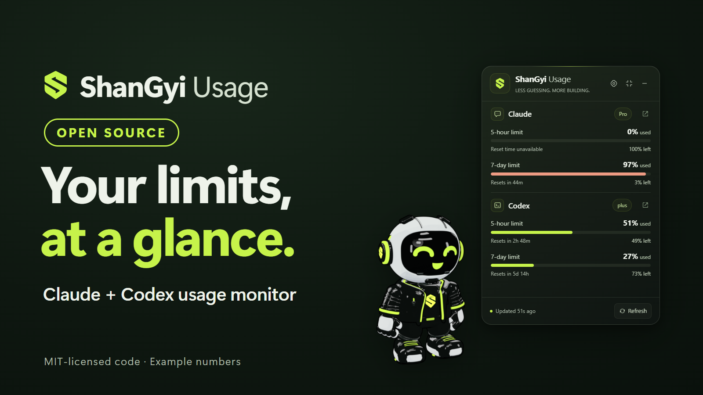
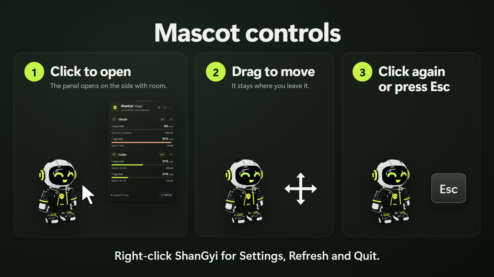
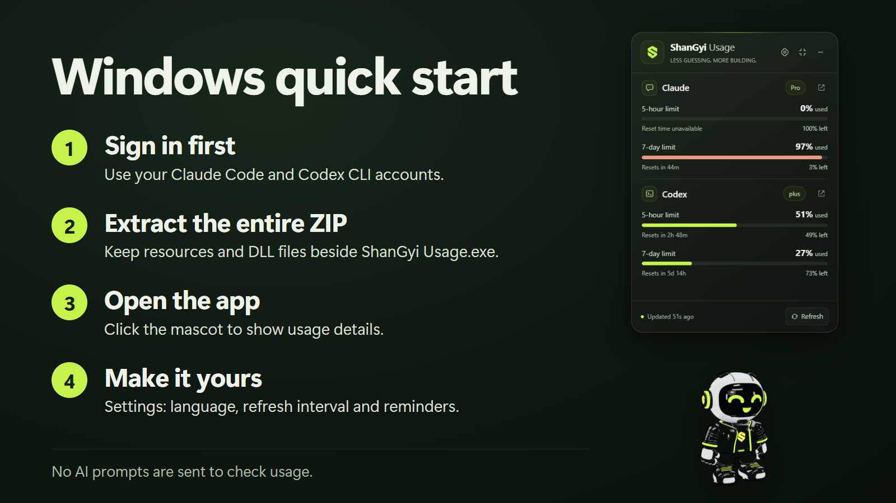
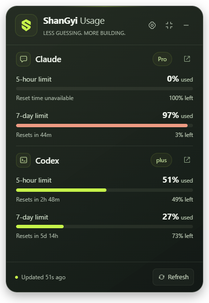

# ShanGyi Usage

[English](README.md) · [မြန်မာ](README.my.md) · [ไทย](README.th.md)

วิดเจ็ตลอยบนเดสก์ท็อป Windows สำหรับดูขีดจำกัดการใช้งาน Claude และ Codex
พร้อมมาสคอต ShanGyi แบบ 3D

> **โปรเจกต์อิสระ** ShanGyi Usage ไม่มีส่วนเกี่ยวข้อง ไม่ได้รับการรับรอง
> หรือสนับสนุนจาก Anthropic หรือ OpenAI ชื่อ "Claude" และ "Codex" เป็นของ
> เจ้าของแต่ละราย ใช้เพื่อบอกว่าแอปอ่านข้อมูลจากบัญชีใดเท่านั้น
> แอปไม่มีโลโก้ของผู้ให้บริการ

## ภาษาไทย

คลิกมาสคอตเพื่อดูรายละเอียด เปิดการตั้งค่า แล้วเลือก **Language → ไทย**
แอปจะจดจำภาษาเมื่อปิดและเปิดใหม่ คลิกมาสคอตอีกครั้งหรือกด Escape
เพื่อซ่อนรายละเอียด ลากมาสคอตเพื่อย้ายตำแหน่ง

แผงรายละเอียดจะเปิดด้านบนมาสคอต ถ้าด้านบนมีพื้นที่ไม่พอจะเปิดด้านล่าง
หรือด้านข้างแทน มาสคอตอยู่ที่เดิมเสมอ

คลิกขวาที่มาสคอตเพื่อเปิดเมนู Settings, Refresh และ Quit

## Windows

ดาวน์โหลด `ShanGyi-Usage-<version>-win-x64.zip` จาก
[หน้า Releases](https://github.com/saimwankhaung/shangyi-usage/releases)
ตรวจสอบไฟล์กับ `SHA256SUMS.txt` ใน release เดียวกันได้ด้วย `Get-FileHash`
ใน PowerShell ไฟล์ EXE ไม่ได้ลงนามดิจิทัล Windows SmartScreen จึงอาจเตือน
ให้กด **More info → Run anyway** เมื่อ checksum ตรงกันเท่านั้น

แตกไฟล์ ZIP ทั้งหมดไว้ในโฟลเดอร์เดียวกัน แล้วเปิด **ShanGyi Usage.exe**
อย่าย้ายเฉพาะไฟล์ EXE เพราะต้องใช้ไฟล์ DLL และโฟลเดอร์ resources ด้วย

> **ขณะเชื่อมต่อ VS Code bridge อย่าย้ายหรือลบโฟลเดอร์แอป** VS Code จะเปิด
> Claude Code ผ่าน `ShanGyiClaudeBridge.exe` ในโฟลเดอร์นี้ ถ้าโฟลเดอร์หายไป
> Claude Code ใน VS Code จะเปิดไม่ได้ ให้กด **Restore** ในการตั้งค่าก่อนย้ายหรือลบ

## macOS (รุ่นพัฒนา ไม่มีการเผยแพร่)

ซอร์สโค้ดสร้างไฟล์ macOS ได้ แต่ยังไม่มี release สำหรับ Mac
ตัวอ่านบัญชี Claude บน Mac ไม่ใช้ตัวเชื่อมต่อ PowerShell หรือ Windows EXE

ต้องติดตั้งและเข้าสู่ระบบใน Claude Code / Codex CLI ก่อน
แอปค้นหา Claude จากส่วนขยาย VS Code, `~/.local/bin/claude`, Homebrew และ PATH
ค้นหา Codex จากแอป Codex/ChatGPT ใน Applications, Homebrew และ PATH
หากไม่พบ Codex ให้เลือกไฟล์โปรแกรม CLI ในการตั้งค่า

ไฟล์ macOS ที่สร้างจาก Windows เป็นไฟล์พัฒนาแบบ unsigned และยังไม่ได้ทดสอบ
การเปิดใช้งานบนเครื่อง Mac จริง ไม่ใช่รุ่นที่ลงนาม Developer ID หรือ notarized
การสร้างบน Mac ด้วย `npm ci` และ `npm run package` จะสร้าง ZIP สำหรับสถาปัตยกรรม
ของเครื่องและตรวจสอบลายเซ็นแบบ ad-hoc ซึ่งยังไม่ใช่ลายเซ็นสำหรับเผยแพร่สาธารณะ

## ข้อมูลและการแจ้งเตือน

- ป้ายข้างชื่อผู้ให้บริการแสดงแพ็กเกจที่ได้รับจากบัญชี แอปไม่เดาชื่อแพ็กเกจเอง
- **used** คือเปอร์เซ็นต์ที่ใช้ไป และ **left** คือเปอร์เซ็นต์ที่เหลือ ขีดจำกัด 5 ชั่วโมงกับ 7 วันเป็นคนละรอบ
- **Resets in** คือเวลาที่ผู้ให้บริการแจ้งว่าจะรีเซ็ต ถ้าแสดง **Reset time unavailable** แปลว่ายังไม่มีข้อมูลเวลานั้น
- **Updated** แสดงอายุข้อมูล ส่วน **Last known** หมายถึงข้อมูลล่าสุดที่มีแต่เก่าแล้ว
- กด **Refresh** เพื่ออ่านข้อมูลใหม่ โดยไม่ส่งพรอมป์ต์ AI

ตัวเลขในภาพเป็นตัวอย่าง การใช้งานและเวลาที่รีเซ็ตขึ้นอยู่กับบัญชีของคุณ

แอปอ่านข้อมูลบัญชีด้วย CLI ของผู้ให้บริการ ไม่ส่งพรอมป์ต์ AI เพื่ออ่านโควตา
ไม่เก็บโทเค็นเข้าสู่ระบบหรือบทสนทนา อัปเดตทุก 1 นาทีโดยค่าเริ่มต้น
ข้อมูลเก่าหรือเลยเวลารีเซ็ตจะแสดงว่าเป็นข้อมูลล่าสุดที่มี ไม่เดาว่าโควตากลับเป็นศูนย์
บางบัญชีหรือเวอร์ชัน CLI อาจไม่ส่งข้อมูลขีดจำกัด

แจ้งเตือนเมื่อข้าม 80%, 95% หรือ 100% โดยไม่แจ้งซ้ำในรอบเดียวกัน
ไม่แจ้งเตือนข้อมูลที่สูงอยู่แล้วตอนเปิดแอป มีช่วงพัก 30 นาทีต่อผู้ให้บริการ
ยกเว้นการถึง 100% ซึ่งแจ้งได้หนึ่งครั้ง

## ถอนการติดตั้ง

1. ในการตั้งค่า กด **Restore** สำหรับแหล่ง Claude ที่เชื่อมต่อไว้
2. เลือก Quit จากเมนูถาดระบบ
3. ลบโฟลเดอร์แอป และ `%APPDATA%\ShanGyi Usage` หากต้องการลบการตั้งค่าและข้อมูลโควตาที่บันทึกไว้

ถ้าลบโฟลเดอร์ไปแล้วขณะเชื่อมต่อ VS Code bridge และ Claude Code ใน VS Code เปิดไม่ได้
ให้เปิด `%APPDATA%\Code\User\settings.json` (VS Code: **Preferences: Open User Settings (JSON)**)
ลบบรรทัด `"claudeCode.claudeProcessWrapper"` บันทึก แล้วสั่ง **Developer: Reload Window**

## สิทธิ์ใช้งาน

ซอร์สโค้ดใช้ MIT ส่วนมาสคอต โลโก้ และไอคอน ShanGyi ใช้
`BRAND-ASSETS-LICENSE.md` อนุญาตให้ใช้แอปตามปกติและแจกฟรีเพื่อวัตถุประสงค์
ที่ไม่ใช่เชิงพาณิชย์ หากขายหรือเผยแพร่เชิงพาณิชย์ ต้องเปลี่ยนมาสคอต
โลโก้ ไอคอน และชื่อแบรนด์เป็นของตนเองหรือที่ได้รับสิทธิ์อย่างเหมาะสม
ชื่อ Claude และ Codex เป็นของเจ้าของแต่ละราย แอปนี้ไม่มีโลโก้ของผู้ให้บริการ
